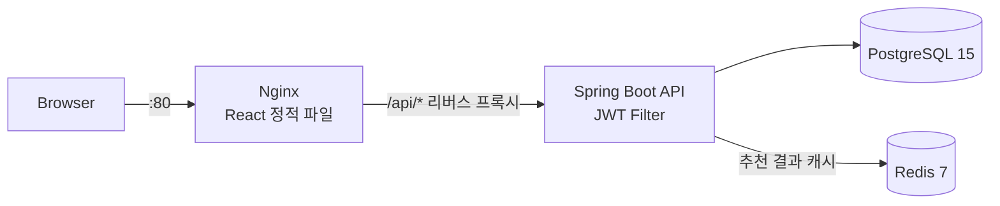
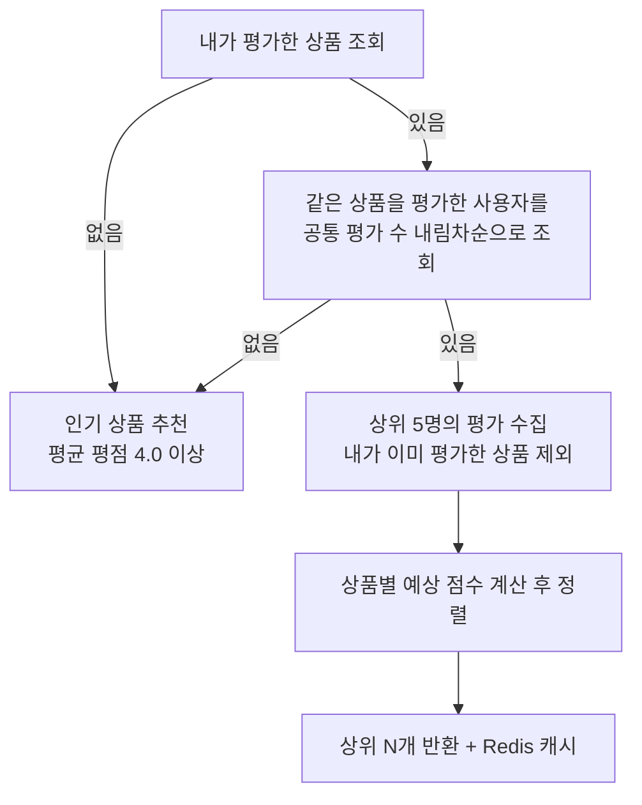

# 🛒 Commerce Web — 협업 필터링 추천 기반 쇼핑몰

> 사용자의 평가 이력으로 **취향이 비슷한 사용자를 찾아 상품을 추천**하고, 추천 결과를 Redis에 캐싱하는 Spring Boot + React 쇼핑몰


| 항목 | 내용 |
| --- | --- |
| 개발 기간 | 2026.01 |
| 개발 인원 | 2인 (나영준, 문무찬) — 본 저장소는 나영준이 통합 · 정리 |
| 나영준 담당 | 추천 시스템 · Redis 캐시, Spring Security/JWT 인증, 주문 · 리뷰 · 판매 통계 API, Docker Compose 인프라 및 AWS EC2 배포, 프론트엔드 화면 |

---

## ✨ 주요 기능

| 구분 | 기능 |
| --- | --- |
| **회원** | 이메일 회원가입/로그인, 가입 시 역할 선택(구매자 `CUSTOMER` / 판매자 `SELLER`), JWT 발급 |
| **상품** | 카테고리 · 상품명 검색, 상세 조회 시 조회수 증가, 인기 상품(평점 → 조회수 순 TOP 10), 신상품(최근 등록 TOP 10) |
| **개인화 추천** | 평가 이력 기반 사용자 협업 필터링, 신규 사용자에게는 인기 상품으로 대체 추천 |
| **주문** | 상품 주문, 내 주문 내역, 본인 주문만 취소 |
| **리뷰** | **실제로 주문한 상품에만** 주문 1건당 리뷰 1개 작성, 본인 리뷰만 수정/삭제, 작성 시 상품 평균 평점 갱신 |
| **판매 통계** | 판매자 전용 화면에서 상품별 매출액 · 판매 수량 · 평균 평점 집계 |

## 🏗 아키텍처



- 네 개의 서비스(PostgreSQL, Redis, Spring Boot, Nginx)를 **Docker Compose 하나로 구성**하고 AWS EC2에 배포했습니다.
- 백엔드와 프론트엔드 모두 **멀티 스테이지 빌드**를 사용합니다. 백엔드는 JDK 이미지에서 빌드하고 JRE 이미지로 실행하며, 프론트엔드는 Node로 빌드한 정적 파일만 Nginx 이미지에 담습니다.
- 브라우저는 Nginx 한 곳에만 요청하고 `/api/*`는 Nginx가 백엔드 컨테이너로 전달하므로, 운영 환경에서 프론트와 API가 같은 출처를 사용합니다.

## 🛠 기술 스택

| 구분 | 기술 |
| --- | --- |
| Backend | Java 21, Spring Boot 3.4, Spring Data JPA, Spring Security, jjwt 0.11, Spring Cache |
| Database / Cache | PostgreSQL 15, Redis 7 |
| Frontend | React 19, Vite, React Router 7, Axios |
| Infra | Docker, Docker Compose, Nginx, AWS EC2 |
| Test | JUnit 5, Mockito, Spring Boot Test |

---

## 💡 핵심 구현

### 1. 사용자 기반 협업 필터링 추천 ([RecommendationService](backend/api-server/src/main/java/com/commerceweb/service/RecommendationService.java))

"나와 같은 상품을 많이 평가한 사람이 높게 평가한 다른 상품"을 추천합니다.



- **유사 사용자 탐색은 DB에서 한 번에** 처리합니다. `ratings` 테이블을 셀프 조인해 사용자별 공통 평가 수를 집계하는 네이티브 쿼리로, 애플리케이션에서 전체 평가 데이터를 불러와 비교하지 않습니다.

  ```sql
  SELECT r2.user_id, COUNT(*) AS common_count
  FROM ratings r1 JOIN ratings r2 ON r1.product_id = r2.product_id
  WHERE r1.user_id = :userId AND r2.user_id != :userId
  GROUP BY r2.user_id ORDER BY common_count DESC
  ```
- **계산량 제한** — 유사 사용자를 상위 K=5명으로 제한해 사용자 수가 늘어도 추천 계산 비용이 일정 수준을 넘지 않게 했습니다.
- **Cold Start 대응** — 평가 기록이 없는 신규 사용자나 유사 사용자가 없는 경우, 그리고 단계별 조회 중 예외가 나는 경우 모두 인기 상품으로 대체해 **추천 영역이 비어 보이지 않게** 했습니다.
- **Redis 캐싱** — `@Cacheable(key = "#userId + '_' + #limit")`로 사용자별 결과를 캐싱하고, 평가가 바뀌면 추천 캐시를 비워 오래된 추천이 남지 않게 했습니다. Redis에 저장하기 위해 `Product` 엔티티에 직렬화를 적용했습니다.
- **테스트** — Mockito로 저장소를 대체해 다음 시나리오를 검증했습니다. ([RecommendationServiceTest](backend/api-server/src/test/java/com/commerceweb/service/RecommendationServiceTest.java))
  - 신규 사용자 → 인기 상품 추천
  - 이미 평가한 상품은 추천에서 제외
  - 유사 사용자가 없으면 인기 상품으로 대체
  - 카테고리 내 평점순 추천

### 2. JWT 기반 무상태 인증과 역할 권한

- 세션 없이(`STATELESS`) 요청마다 `Authorization: Bearer` 토큰을 검증하는 `OncePerRequestFilter`를 직접 구현했습니다. 토큰 subject의 사용자 ID로 회원을 조회해 `ROLE_` 권한을 SecurityContext에 넣습니다.
- 비밀번호는 BCrypt로 해시하고, 상품 조회 · 로그인은 공개, 주문은 로그인 사용자, **판매 통계는 판매자/관리자만** 접근하도록 URL별 권한을 나눴습니다.
- CORS는 허용 출처 · 메서드 · 헤더를 명시적으로 지정했습니다.
- 프론트엔드는 Axios 인터셉터로 모든 요청에 토큰을 자동 첨부하고, `401`이 오면 저장된 인증 정보를 지우고 로그인 화면으로 보냅니다.

### 3. 구매 이력으로 검증하는 리뷰

리뷰는 상품이 아니라 **주문에 연결**됩니다. 작성 시 서버가 ① 그 주문이 요청자 본인의 주문인지, ② 이미 리뷰를 쓴 주문인지 확인하므로, 사지 않은 상품에 리뷰를 달거나 같은 주문으로 리뷰를 반복해 평점을 조작할 수 없습니다. 리뷰가 작성 · 수정될 때마다 상품 평균 평점을 다시 계산해 인기 상품 정렬에 반영합니다.

### 4. JPQL 집계로 만든 판매 통계

주문 데이터를 상품 기준으로 `GROUP BY`해 매출액 · 판매 수량 · 평균 평점을 DTO로 바로 받는 JPQL 생성자 표현식을 사용했습니다. 엔티티를 모두 불러와 자바에서 합산하지 않고 DB 집계 결과만 전달합니다.

## 🔧 트러블슈팅

> 셀프 코드 리뷰로 찾은 버그(JWT 위조 토큰 500, 추천 순위 뒤섞임, Nginx 경로, 판매 통계 집계 등)와 해결 과정은 [`docs/troubleshooting.md`](docs/troubleshooting.md)에 정리했습니다. PR마다 CI(`.github/workflows/ci.yml`)가 테스트를 실행합니다.

| 문제 | 원인 | 해결 |
| --- | --- | --- |
| 배포 환경에서 API 호출이 404 | 프론트엔드 호출 경로와 백엔드 매핑 경로 불일치 | 모든 API에 `/api` 접두사를 통일하고 Nginx 리버스 프록시 경로와 맞춤 |
| 로그인 후 판매자 화면 접근 불가 | 로그인 응답에서 사용자 역할(role)이 누락됨 | 인증 응답 DTO에 역할을 포함하고 프론트 인증 상태에 저장 |
| 판매자 계정 주문 시 403 | 주문 API 권한이 `CUSTOMER`만 허용 | 역할별 권한 규칙을 재정리해 판매자도 주문 가능하도록 수정 |
| 추천 결과 Redis 저장 실패 | 캐시 대상 엔티티가 직렬화 불가능 | `Product`에 `Serializable` 적용 |

## 📂 프로젝트 구조

```
├── backend/api-server/src/main/java/com/commerceweb
│   ├── config/        # SecurityConfig, JwtAuthenticationFilter, RedisCacheConfig
│   ├── security/jwt/  # JwtProvider (토큰 발급·검증)
│   ├── controller/    # Auth, Product, Order, Review, Recommendation, Sales
│   ├── service/       # 비즈니스 로직 (추천, 주문, 리뷰, 통계 등)
│   ├── repository/    # Spring Data JPA, JPQL/네이티브 쿼리
│   ├── entity/        # User, Product, Order, Review, Rating
│   └── dto/
├── frontend/src
│   ├── pages/         # 홈, 상품, 주문 내역, 리뷰 관리, 판매 통계, 로그인/회원가입
│   ├── components/    # 상품 카드, 추천 섹션, 평점 모달
│   ├── services/      # Axios 인스턴스 · 인터셉터
│   └── context/       # 인증 상태 (AuthContext)
└── compose.yaml       # PostgreSQL · Redis · Backend · Frontend(Nginx)
```

## 🚀 실행 방법

```bash
cp .env.example .env        # DB 계정, JWT_SECRET 입력
docker compose up --build   # http://localhost
```

개발 중에는 `docker compose watch`로 소스 변경 시 백엔드는 재빌드, 프론트엔드는 파일 동기화되도록 설정했습니다.

## 🔭 한계와 다음 단계

현재 주문은 결제 연동 없이 즉시 완료 처리되는 구조입니다. 실제 커머스 수준으로 가기 위해 다음을 계획하고 있습니다.

- **재고와 동시성 제어** — 상품에 재고 컬럼을 추가하고, 동시에 같은 상품을 주문할 때 재고가 음수가 되지 않도록 비관적 락(`SELECT … FOR UPDATE`)과 낙관적 락(`@Version`)을 비교 적용한 뒤 동시 요청 테스트로 검증
- **주문 상태 전이** — 문자열 상태를 Enum으로 바꾸고 `결제 대기 → 결제 완료 / 실패 → 취소` 전이 규칙을 도메인 메서드로 강제, 취소 시 물리 삭제 대신 상태 변경으로 이력 보존
- **평가 데이터 통합** — 추천은 `ratings` 테이블을, 화면의 리뷰는 `reviews` 테이블을 사용해 리뷰가 추천에 반영되지 않습니다. 평점 저장 API를 노출하거나 두 데이터를 통합해 추천 품질을 높일 예정
- **유사도 고도화** — 공통 평가 수 기반 유사도를 평점 차이까지 반영하는 코사인 유사도 / 피어슨 상관계수로 개선
